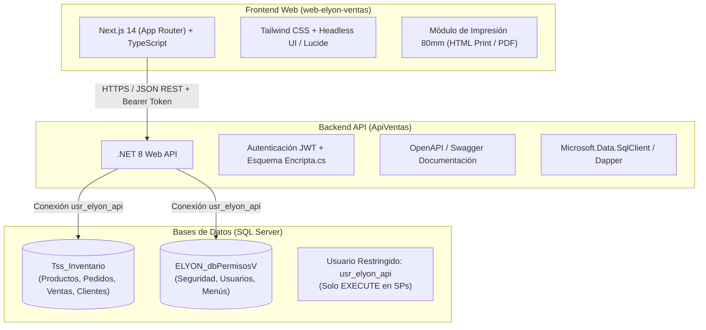

# Plan de Desarrollo: Migración Web - AppElyonVentas (Frutería del Puerto)

**Fecha de Actualización:** 2026-11-05  
**Estado General:** Fase 0 (Preparación) Completada al 100% | Listo para Sprint 1  
**Proyecto Original:** `D:\Personales\AppElyonVentas-master` (WinForms .NET 4.0 + ASMX + SQL Server)  
**Proyecto Destino:** Web Application (.NET 8 Web API + Next.js 14 / React + Tailwind CSS)

---

## 1. Visión General y Objetivos

El objetivo es migrar la aplicación de escritorio **AppElyonCXC** a una versión web moderna, ágil y responsiva manteniendo la operación continua del negocio.

### Metas Principales:
1. **Conservar la lógica de negocio y datos:** Reutilizar los **~140 Stored Procedures** existentes en `Tss_Inventario` y `ELYON_dbPermisosV`.
2. **Arquitectura desacoplada:** Separar completamente el Frontend (SPA/SSR) del Backend (REST API con JWT).
3. **Cero dependencias obsoletas:** Eliminar Crystal Reports, XML SOAP genéricos y librerías de escritorio no compatibles con la web.
4. **Impresión térmica ágil:** Soportar emisión e impresión de tickets de mostrador (80 mm) y notas de remisión directamente desde la interfaz web.
5. **Seguridad y menor privilegio:** Eliminar el uso de contraseñas de superusuario (`sa`) y operar la API con usuario SQL de permisos de solo ejecución (`GRANT EXECUTE`).

---

## 2. Stack Tecnológico Seleccionado



---

## 3. Seguridad de Base de Datos y Credenciales (Configurado)

Se ha creado un usuario técnico exclusivo para la API, aplicando el principio de **menor privilegio**:

* **Login:** `usr_elyon_api`
* **Permisos otorgados:** `GRANT EXECUTE` sobre los Stored Procedures en `Tss_Inventario` y `ELYON_dbPermisosV`.
* **Restricción:** El acceso directo a tablas (`SELECT`, `INSERT`, `UPDATE`, `DELETE`) y operaciones DDL queda estrictamente denegado.
* **Script de aprovisionamiento:** [`db/01_crear_usuario_api.sql`](file:///D:/Personales/AppElyonVentas-master/db/01_crear_usuario_api.sql)

### Cadenas de Conexión para la API (`appsettings.json`):
```json
{
  "ConnectionStrings": {
    "Inventario": "Server=localhost;Database=Tss_Inventario;User Id=usr_elyon_api;Password=Ely0n_V3ntas#2026!Sec;TrustServerCertificate=True;",
    "Seguridad": "Server=localhost;Database=ELYON_dbPermisosV;User Id=usr_elyon_api;Password=Ely0n_V3ntas#2026!Sec;TrustServerCertificate=True;"
  }
}
```

---

## 4. Estructura del Repositorio de Desarrollo

```
D:\Personales\AppElyonVentas-master\
├── backend/
│   └── ApiVentas/                      # Proyecto Web API .NET 8 (Sprint 1)
│       ├── Controllers/                # Auth, Pedidos, Remisiones, Pagos, Catalogos, Reportes
│       ├── DTOs/                       # Requests y Responses tipados en JSON
│       ├── Repositories/               # Invocación a Stored Procedures existentes
│       ├── Services/                   # Lógica de cálculo (totales, crédito, folios)
│       └── Security/                   # Hasher compatible con Encripta.cs + JWT
├── frontend/
│   └── web-elyon-ventas/               # Proyecto Next.js 14 (Sprint 1)
│       ├── app/                        # Rutas dinámicas basadas en sp_MenuPorUsuario
│       │   ├── (auth)/login/
│       │   ├── pedidos/
│       │   ├── cobranza/
│       │   ├── catalogos/
│       │   └── reportes/
│       ├── components/                 # Modales de búsqueda, tablas paginadas, formularios
│       └── lib/                        # Cliente HTTP con interceptor de tokens
├── db/                                 # Scripts de línea base y migraciones
│   ├── 01_crear_usuario_api.sql        # Usuario exclusivo y permisos
│   ├── Tss_Inventario_routines.sql     # 40 Stored Procedures y Vistas
│   ├── Tss_Inventario_schema.txt       # Estructura de tablas
│   ├── ELYON_dbPermisosV_routines.sql  # 75 Stored Procedures y Vistas
│   └── ELYON_dbPermisosV_schema.txt    # Estructura de tablas
└── docs/                               # Mapeo funcional y guías de despliegue
```

---

## 5. Cronograma de Desarrollo por Sprints (Fases)

### **Sprint 0: Línea Base, Seguridad y Aseguramiento ( Estado: 100% COMPLETADO)**
- [x] Extracción y respaldo de rutinas SQL (40 SPs de `Tss_Inventario` y 75 de `ELYON_dbPermisosV`).
- [x] Extracción de esquemas DDL de tablas y persistencia en `db/`.
- [x] Inicialización de control de versiones Git y exclusión de archivos con sectores dañados (`Form1*`, `frmAniversario*`).
- [x] Auditoría de credenciales: eliminación de dependencia del usuario `sa`.
- [x] Creación del usuario técnico `usr_elyon_api` con permisos exclusivos `EXECUTE`.
- [x] Pruebas de conexión y validación de seguridad (bloqueo de `SELECT` directo y ejecución exitosa de SPs).

---

### **Sprint 1: Núcleo Backend & Autenticación (Duración: 2 semanas) ⏳ SIGUIENTE**
* **Objetivo:** Tener la Web API operativa con autenticación idéntica a la actual y frontend conectado.
* **Entregables:**
  1. Solución .NET 8 Web API con Swagger UI, CORS configurado y manejo centralizado de excepciones.
  2. Implementación de algoritmo de cifrado compatible con `Encripta.cs` de la solución WinForms.
  3. `AuthController`: Endpoint de login llamando a `spr_VerificaUsuario` y emisión de tokens JWT.
  4. Endpoint de carga de menú y permisos dinámicos (`sp_MenuPorUsuario`, `spCargaBotonesUsuarioMenu`).
  5. Shell de frontend en Next.js con pantalla de Login, guardián de rutas (`middleware.ts`) y sidebar dinámico según permisos del usuario.

---

### **Sprint 2: Módulo de Catálogos (Duración: 2 semanas)**
* **Objetivo:** Administración de entidades principales en la web.
* **Entregables:**
  1. **Productos:** Lista con búsqueda reactiva, modal CRUD, combos de unidades de medida y asignación de grupo/departamento.
  2. **Clientes:** Gestión de cartera, historial de movimientos, límite y días de crédito.
  3. **Proveedores y Vendedores:** Catálogo y asignación a rutas/zonas.
  4. Componente reutilizable `BuscadorModal` para reemplazar los formularios WinForms (`FrmBuscarClientes`, `FrmBuscarProductos`, etc.).

---

### **Sprint 3: Núcleo de Ventas, Pedidos y Tickets (Duración: 3 semanas) ⚠️ CRÍTICO**
* **Objetivo:** Reemplazar el formulario central `Frm_GenerarPedido.cs` (1,324 líneas).
* **Entregables:**
  1. **Captura Rápida de Pedidos:** Búsqueda por código de barras o texto, atajos de teclado, cálculo reactivo de IVA, subtotales y totales.
  2. **Condiciones Comerciales:** Validación de límite de crédito, días de crédito y reserva de folios correlativos.
  3. **Conversión a Nota de Remisión:** Transición de estado de pedido a remisión.
  4. **Emisión de Tickets (80 mm):** Vista de impresión térmica optimizada en HTML/CSS (`window.print()`).

---

### **Sprint 4: Cuentas por Cobrar (CxC) y Cancelaciones (Duración: 2 semanas)**
* **Objetivo:** Registro de cobranza y control de documentos.
* **Entregables:**
  1. **Cobranza:** Registro de pago de cliente (`Frm_Registrar_Pago_Cliente.cs`), aplicación a notas pendientes y boleta de abono.
  2. **Estado de Cuenta:** Consulta detallada de saldos vencidos y por vencer por cliente.
  3. **Cancelaciones:** Cancelación formal de notas de remisión con validación de permisos y motivo en bitácora.
  4. **Reimpresión:** Búsqueda y reimpresión ágil de documentos históricos.

---

### **Sprint 5: Reportes y Exportación (Duración: 1.5 semanas)**
* **Objetivo:** Sustituir los 8 reportes de Crystal Reports.
* **Entregables:**
  1. Reporte de ventas diarias y resumen por vendedor/empresa.
  2. Reporte de movimientos de inventario y saldos.
  3. Exportación a Excel (`.xlsx`) y PDF descargable para estados de cuenta ejecutivos.

---

### **Sprint 6: Administración de Seguridad y Perfiles (Duración: 1.5 semanas)**
* **Objetivo:** Control granular de accesos desde la interfaz web.
* **Entregables:**
  1. Alta y edición de usuarios, asignación de roles y estados.
  2. Asignación de permisos por menú y acciones (Guardar, Modificar, Cancelar, Imprimir).
  3. Bitácora de accesos y auditoría de eventos.

---

### **Sprint 7: Pruebas en Paralelo y Puesta en Producción (Duración: 2 semanas)**
* **Objetivo:** Despliegue en ambiente real sin interrupción operativa.
* **Entregables:**
  1. **Pruebas en espejo:** Captura paralela de pedidos en WinForms y Web para validar folios, saldos y totales al centavo.
  2. Pruebas de campo con impresoras de tickets en cajas.
  3. Despliegue en IIS / Node.js con certificados SSL (HTTPS).
  4. Capacitación a usuarios y retiro programado de la app de escritorio.

---

## 6. Matriz de Equivalencias (WinForms $\rightarrow$ Web)

| Módulo WinForms | Archivo Principal | Equivalente Web (Ruta / Componente) | Endpoint API |
| :--- | :--- | :--- | :--- |
| Login / Inicio | `frmLogin.cs` / `FrmMenu.cs` | `/login` + `SidebarLayout` dinámico | `POST /api/auth/login`<br/>`GET /api/auth/menu` |
| Pedidos | `Frm_GenerarPedido.cs` | `/pedidos/nuevo` | `POST /api/pedidos`<br/>`POST /api/pedidos/remision` |
| Búsqueda de Pedidos | `FrmBuscarPedidos.cs` | `/pedidos` (DataGrid interactivo) | `GET /api/pedidos` |
| Pagos Clientes | `Frm_Registrar_Pago_Cliente.cs` | `/cobranza/pagos` | `POST /api/pagos/registrar` |
| Catálogo Productos | `Frm_Producto.cs` | `/catalogos/productos` | `GET, POST, PUT /api/productos` |
| Catálogo Clientes | `FrmClientes.cs` | `/catalogos/clientes` | `GET, POST, PUT /api/clientes` |
| Cancelaciones | `FrmCancelaNotasRemision.cs` | `/cobranza/cancelaciones` | `POST /api/remisiones/cancelar` |
| Impresión Tickets | `Ticket.cs` + `.rpt` | `/impresion/ticket/[id]` (Vista 80mm) | `GET /api/pedidos/[id]/ticket-data` |
